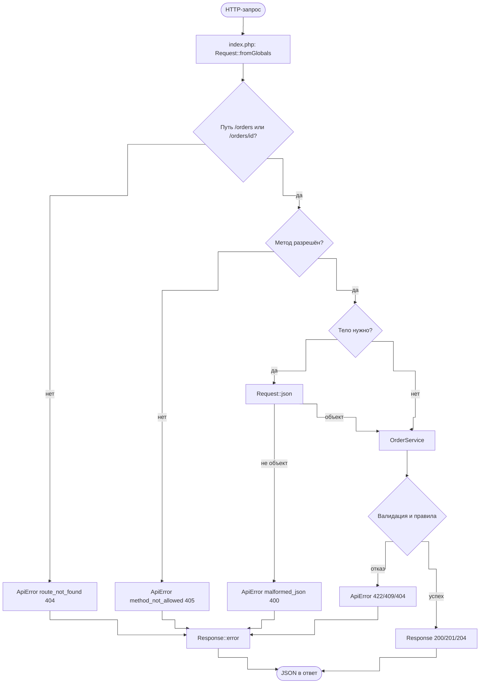
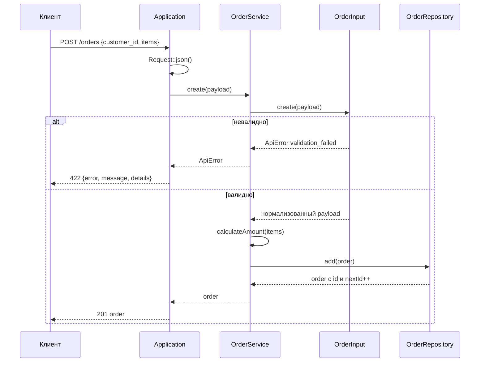
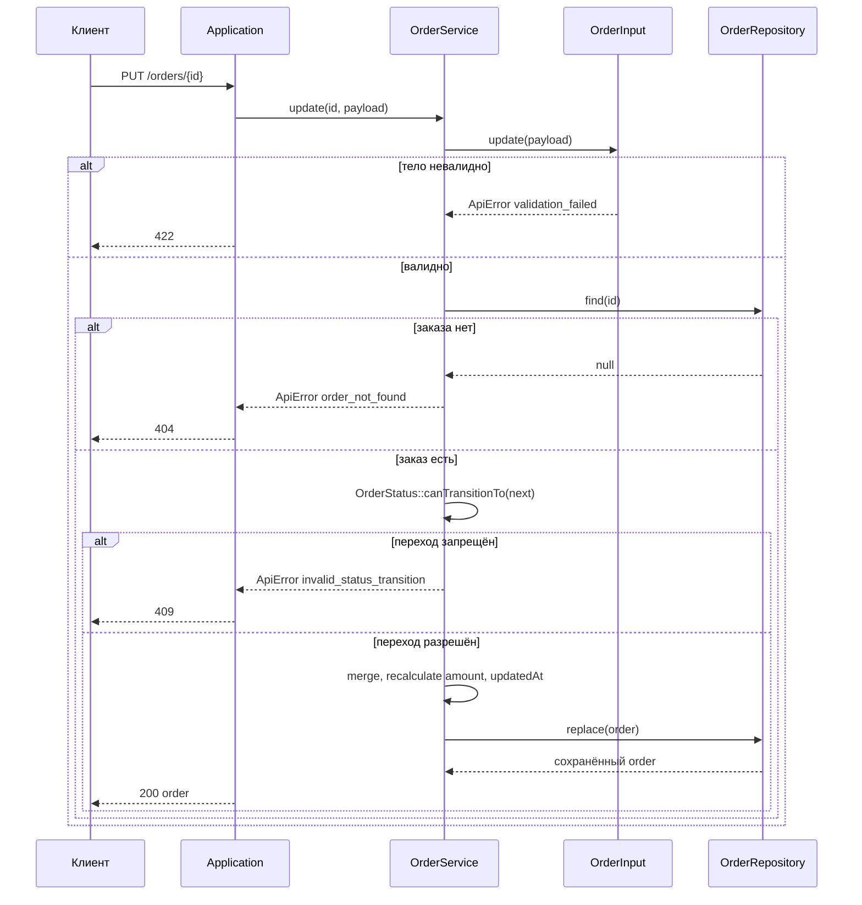
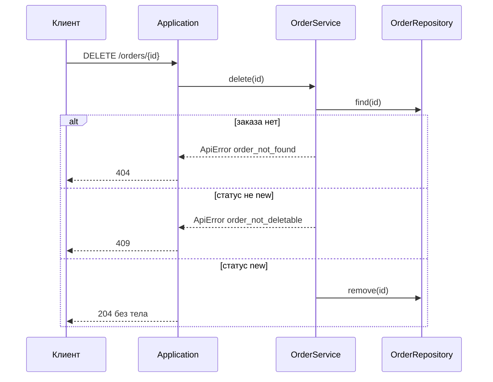
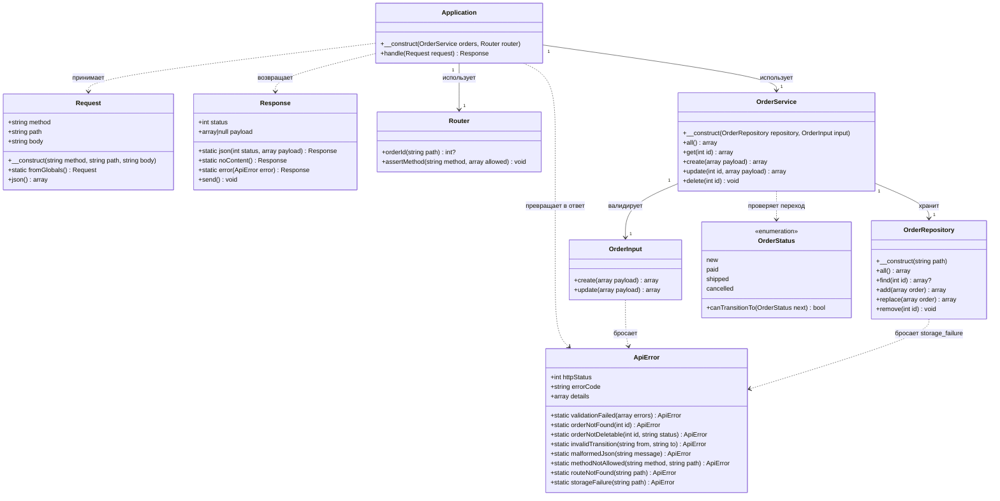

# Design

## Context

См. `proposal.md` — Why. Текущее состояние, которое формирует подход:

- `src/public/index.php` — единственная точка входа, печатает `Hello, world`.
  Фронт-контроллера, автозагрузчика приложения и слоя HTTP в проекте нет.
- nginx (`docker/nginx/conf.d/site.conf`) отдаёт только `*.php` через
  `try_files $uri =404`; путь `/orders` без правки конфига уйдёт в 404 от nginx.
- `src/composer.json` не содержит секции `autoload`; тесты Codeception подключены,
  набор `Unit` использует только `Asserts`, `Acceptance` настроен на чужой URL
  `http://localhost/myapp`.
- БД (`db`, PostgreSQL 13.3) существует, но по условию задачи данные лежат в JSON.

## Goals / Non-Goals

**Goals:**

- Один процесс: запрос приходит в `src/public/index.php`, маршрутизируется внутри
  приложения и завершается JSON-ответом или JSON-ошибкой.
- Слои разделены так, что бизнес-правила заказа тестируются в `Unit` без HTTP,
  а HTTP-контракт — через `Application::handle()` без nginx.
- Хранилище заменяемо: сервис знает только `OrderRepository` с файловым путём.

**Non-Goals:**

- Аутентификация, авторизация, rate limiting.
- Пагинация и фильтры списка (см. spec — `GET /orders` отдаёт всё).
- Транзакции, конкурентный доступ, блокировки файла: сценарий — один разработчик
  и ручные проверки.
- Миграция на PostgreSQL: `db`-сервис не используется.
- Acceptance-тесты через реальный браузер: только `PhpBrowser`.

## Decisions

### 1. Структура: `src/app/` с PSR-4 `App\`, без фреймворка

`src/composer.json` получает `autoload.psr-4: {"App\\": "app/"}`. Классы:

- `App\Http\*` — транспорт: `Request`, `Response`, `Router`, `Application`.
- `App\Order\*` — предметная область: `OrderStatus`, `OrderInput`,
  `OrderRepository`, `OrderService`.
- `App\ApiError` — единственный способ сообщить об ошибке наружу.

Альтернатива — один файл `index.php` на всё — отвергнута: бизнес-правила
(расчёт `amount`, переходы статусов) невозможно протестировать в `Unit`, а спека
требует отдельного покрытия валидации и хранилища.

Альтернатива — Slim/MicroKernel — отвергнута: запрет внешних фреймворков.

### 2. Маршрутизация: регулярка в `Router`, путь из `REQUEST_URI`

`Router::orderId(string $path): ?int` — чистая функция над нормализованным путём:

- `/orders` → `null`
- `/orders/{целое}` → `id`
- всё остальное → `ApiError::routeNotFound()`

`Request::fromGlobals()` берёт `parse_url($_SERVER['REQUEST_URI'], PHP_URL_PATH)`,
снимает хвостовой `/` и query string. Это делает `Application` тестируемым без
суперглобалов: тесты конструируют `new Request('GET', '/orders/1', '')`.

nginx: в `site.conf` добавляется `location / { try_files $uri /index.php$is_args$args; }`.
Без этого `/orders` не доходит до PHP.

### 3. Хранилище: один JSON-объект `{"nextId": N, "orders": [...]}`

`Array<Order>` как корень файла не позволяет отличить «нет заказов» от
«следующий id переиспользован». Поэтому корень — объект:

```json
{
  "nextId": 4,
  "orders": [ { "id": 1, "...": "..." } ]
}
```

- `all()`: файла нет → `[]`. Файл есть → `json_decode(..., true)`, проверка что
  это массив с ключами `nextId` (int > 0) и `orders` (list). Иначе
  `ApiError::storageFailure($path)` — файл не перезаписывается.
- `add()`: `id = nextId`, `nextId++`, запись через `file_put_contents` с
  `LOCK_EX`.
- `replace()` / `remove()`: меняют только `orders`, `nextId` не уменьшают — так
  выполняется требование «id удалённого заказа не переиспользуется».
- Сортировка по `id` выполняется в `all()`, а не полагается на порядок в файле.

Альтернатива — отдельный файл-счётчик — отвергнута: два файла нужно держать
согласованными, что усложняет и без того простое хранилище.

Альтернатива — `max(id)+1` без счётчика — отвергнута: после удаления последнего
заказа его id достался бы следующему (нарушает требование).

### 4. Деньги: целые копейки → float на границе

`amount` хранится числом с двумя знаками. Расчёт:

```php
$total = 0;
foreach ($items as $item) {
    $total += $item['count'] * (int) round($item['cost'] * 100);
}
$amount = round($total / 100, 2);
```

Так `3 × 0.125` даёт `0.38`, а не `0.375` и не артефакт float-сложения.
Присланный клиентом `amount` удаляется из payload до валидации (поле служебное).

### 5. Валидация: один проход, первая ошибка, карта `details`

`OrderInput` проверяет поля по порядку: `customer_id`, `comment`, `status`,
`items[i].{id,name,count,cost}`, затем неизвестные ключи (`array_diff` по
разрешённым). Возвращает `ApiError::validationFailed(['customer_id' => '...'])`
при первой проблеме — `details` содержит одну строку, как зафиксировано в спеке.

Порядок вложенных проверок: `name`, `count`, `cost` — так путь ошибки
предсказуем в тестах (`items[0].count`).

`create()` дополнительно проверяет, что `status`, если передан, равен `new`.
`update()` возвращает только перечисленные в теле изменяемые поля, чтобы сервис
не затирал отсутствующие.

Альтернатива — собирать все ошибки сразу — отвергнута: спека фиксирует первую
ошибку, а полный набор потребовал бы другой формы `details`.

### 6. Статусы: enum с явной таблицей переходов

`OrderStatus` — backed enum (`new`, `paid`, `shipped`, `cancelled`).
`canTransitionTo()` использует `match`:

| from \ to | new | paid | shipped | cancelled |
| --- | --- | --- | --- | --- |
| `new` | ✔ (повтор) | ✔ | ✘ 409 | ✔ |
| `paid` | ✘ 409 | ✔ (повтор) | ✔ | ✔ |
| `shipped` | ✘ 409 | ✘ 409 | ✔ (повтор) | ✘ 409 |
| `cancelled` | ✘ 409 | ✘ 409 | ✘ 409 | ✔ (повтор) |

Проверка перехода живёт в `OrderService::update()`, а не в `OrderInput`:
валидация формы и бизнес-правило перехода — разные отказы (422 против 409).
Порядок в `update()`: валидация тела (422) → поиск заказа (404) → проверка
перехода (409). Тело при этом уже нормализовано, поэтому `PUT /orders/999` с
корректным телом даёт 404, а не 422.

### 7. Ошибка как единственный формат отказа

`ApiError` — исключение с `httpStatus`, `errorCode`, `message`, `details`.
`Application::handle()` ловит его и отдаёт `Response::error()`. Любое
непойманное исключение наружу даёт 500 `storage_failure` без деталей.

Формат: `{"error": "<code>", "message": "<text>"}` + `details` при валидации.
`Content-Type: application/json; charset=utf-8` у всех ответов, включая 204
(без тела).

Альтернатива — исключения разных классов на каждый случай — отвергнута:
`Application` ловил бы их по одному, а `ApiError` с кодом короче и не требует
иерархии ради восьми случаев.

### 8. Тесты: Unit против `Application`, Acceptance — тонкий

Основной контроль — `Unit`:

- `OrderStatusTest`, `OrderInputTest`, `OrderRepositoryTest` — чистые классы, без
  HTTP и без nginx. Хранилище работает с `tmpfile`-путём в `tests/_output/`.
- `ApplicationTest` — `new Application($service)` + `new Request(...)` →
  проверка `status`, декодированного `payload` и исключения `send()` из
  проверки: тесты вызывают `->payload` вместо `send()`, чтобы не перехватывать
  вывод.

Acceptance (`PhpBrowser` на `http://localhost:8093`) — один smoke-тест на полный
цикл CRUD. `src/tests/Acceptance.suite.yml` получает корректный `url`;
`DELETE`-проверки в `PhpBrowser` ограничены, поэтому цикл строится на
`POST → PUT → GET`.

## Процесс



## Последовательности

### Создание заказа



### Обновление заказа и смена статуса



### Удаление заказа



## Классы



## Изменения

| Файл | Класс | Метод (сигнатура) | Действие | Что меняется |
| --- | --- | --- | --- | --- |
| `src/composer.json` | — | — | изменяется | Добавляется секция `autoload` с PSR-4 `App\` → `app/` |
| `src/.gitignore` | — | — | изменяется | Добавляется шаблон `data/orders.json` |
| `docker/nginx/conf.d/site.conf` | — | — | изменяется | Добавляется `location /` с `try_files $uri /index.php$is_args$args`: некорневые пути уходят во фронт-контроллер |
| `src/public/index.php` | — | — | изменяется | Содержимое `Hello, world` заменяется фронт-контроллером: подключает autoload, собирает `Application`, отдаёт ответ |
| `src/data/.gitkeep` | — | — | добавляется | Каталог данных присутствует в репозитории, сам `orders.json` — нет |
| `src/app/ApiError.php` | `App\ApiError` | — | добавляется | Ошибка с HTTP-статусом, кодом и `details`; поля `httpStatus`, `errorCode`, `details` |
| `src/app/ApiError.php` | `App\ApiError` | `static validationFailed(array $errors): self` | добавляется | Ошибка 422 `validation_failed` с картой ошибок по полям |
| `src/app/ApiError.php` | `App\ApiError` | `static orderNotFound(int $id): self` | добавляется | Ошибка 404 `order_not_found` |
| `src/app/ApiError.php` | `App\ApiError` | `static orderNotDeletable(int $id, string $status): self` | добавляется | Ошибка 409 `order_not_deletable` |
| `src/app/ApiError.php` | `App\ApiError` | `static invalidTransition(string $from, string $to): self` | добавляется | Ошибка 409 `invalid_status_transition` |
| `src/app/ApiError.php` | `App\ApiError` | `static malformedJson(string $message): self` | добавляется | Ошибка 400 `malformed_json` |
| `src/app/ApiError.php` | `App\ApiError` | `static methodNotAllowed(string $method, string $path): self` | добавляется | Ошибка 405 `method_not_allowed` |
| `src/app/ApiError.php` | `App\ApiError` | `static routeNotFound(string $path): self` | добавляется | Ошибка 404 `route_not_found` |
| `src/app/ApiError.php` | `App\ApiError` | `static storageFailure(string $path): self` | добавляется | Ошибка 500 `storage_failure` |
| `src/app/Http/Request.php` | `App\Http\Request` | — | добавляется | Запрос с `method`, `path`, `body` |
| `src/app/Http/Request.php` | `App\Http\Request` | `__construct(string $method, string $path, string $body = '')` | добавляется | Создаёт запрос из явных значений, чтобы HTTP-слой тестировался без суперглобалов |
| `src/app/Http/Request.php` | `App\Http\Request` | `static fromGlobals(): self` | добавляется | Собирает запрос из `$_SERVER` и `php://input`, отбрасывает query string и хвостовой `/` |
| `src/app/Http/Request.php` | `App\Http\Request` | `json(): array` | добавляется | Декодирует тело в объект; пустое тело или не-объект — `ApiError::malformedJson()` |
| `src/app/Http/Response.php` | `App\Http\Response` | — | добавляется | Ответ с `status` и `payload: ?array` |
| `src/app/Http/Response.php` | `App\Http\Response` | `static json(int $status, array $payload): self` | добавляется | JSON-ответ с телом |
| `src/app/Http/Response.php` | `App\Http\Response` | `static noContent(): self` | добавляется | Ответ 204 без тела |
| `src/app/Http/Response.php` | `App\Http\Response` | `static error(ApiError $error): self` | добавляется | Ответ из `ApiError`: статус, `error`, `message`, `details` |
| `src/app/Http/Response.php` | `App\Http\Response` | `send(): void` | добавляется | Выставляет код и `Content-Type: application/json; charset=utf-8`, печатает тело, если оно есть |
| `src/app/Http/Router.php` | `App\Http\Router` | `orderId(string $path): ?int` | добавляется | Возвращает `null` для `/orders`, `id` для `/orders/{id}`, бросает `routeNotFound` для прочих путей |
| `src/app/Http/Router.php` | `App\Http\Router` | `assertMethod(string $method, array $allowed): void` | добавляется | Бросает `ApiError::methodNotAllowed()`, если метод не в списке разрешённых |
| `src/app/Http/Application.php` | `App\Http\Application` | `__construct(OrderService $orders, Router $router = new Router())` | добавляется | Собирает HTTP-слой поверх сервиса заказов |
| `src/app/Http/Application.php` | `App\Http\Application` | `handle(Request $request): Response` | добавляется | Диспетчеризует запрос, превращает `ApiError` в JSON-ответ |
| `src/app/Order/OrderStatus.php` | `App\Order\OrderStatus` | — | добавляется | Enum статусов `new`, `paid`, `shipped`, `cancelled` |
| `src/app/Order/OrderStatus.php` | `App\Order\OrderStatus` | `canTransitionTo(self $next): bool` | добавляется | Разрешает цепочку `new → paid → shipped`, ветки в `cancelled`, повтор статуса |
| `src/app/Order/OrderInput.php` | `App\Order\OrderInput` | `create(array $payload): array` | добавляется | Валидирует тело создания, нормализует `customer_id`, `comment`, `items`, `status=new` |
| `src/app/Order/OrderInput.php` | `App\Order\OrderInput` | `update(array $payload): array` | добавляется | Валидирует тело обновления и возвращает только переданные изменяемые поля |
| `src/app/Order/OrderRepository.php` | `App\Order\OrderRepository` | `__construct(string $path)` | добавляется | Файловое хранилище заказов по указанному пути |
| `src/app/Order/OrderRepository.php` | `App\Order\OrderRepository` | `all(): array` | добавляется | Читает все заказы, упорядочивает по `id`; нет файла — пустой массив |
| `src/app/Order/OrderRepository.php` | `App\Order\OrderRepository` | `find(int $id): ?array` | добавляется | Ищет заказ по `id` или возвращает `null` |
| `src/app/Order/OrderRepository.php` | `App\Order\OrderRepository` | `add(array $order): array` | добавляется | Присваивает следующий `id`, пишет заказ в файл и возвращает сохранённый заказ |
| `src/app/Order/OrderRepository.php` | `App\Order\OrderRepository` | `replace(array $order): array` | добавляется | Заменяет заказ с тем же `id`, пишет файл и возвращает сохранённый заказ |
| `src/app/Order/OrderRepository.php` | `App\Order\OrderRepository` | `remove(int $id): void` | добавляется | Удаляет заказ из файла |
| `src/app/Order/OrderService.php` | `App\Order\OrderService` | `__construct(OrderRepository $repository, OrderInput $input = new OrderInput())` | добавляется | Бизнес-правила заказов поверх хранилища и валидатора |
| `src/app/Order/OrderService.php` | `App\Order\OrderService` | `all(): array` | добавляется | Возвращает все заказы |
| `src/app/Order/OrderService.php` | `App\Order\OrderService` | `get(int $id): array` | добавляется | Возвращает заказ или бросает `orderNotFound` |
| `src/app/Order/OrderService.php` | `App\Order\OrderService` | `create(array $payload): array` | добавляется | Валидирует, считает `amount`, проставляет отметки времени и сохраняет заказ |
| `src/app/Order/OrderService.php` | `App\Order\OrderService` | `update(int $id, array $payload): array` | добавляется | Валидирует, проверяет переход статуса, пересчитывает `amount` и сохраняет изменения |
| `src/app/Order/OrderService.php` | `App\Order\OrderService` | `delete(int $id): void` | добавляется | Удаляет заказ только в статусе `new` |
| `src/tests/Unit.suite.yml` | — | — | изменяется | Добавляется `bootstrap: _bootstrap.php` для подключения autoload |
| `src/tests/Unit/_bootstrap.php` | — | — | добавляется | Подключает `vendor/autoload.php` |
| `src/tests/Acceptance.suite.yml` | — | — | изменяется | `url` меняется с `http://localhost/myapp` на `http://localhost:8093` |
| `src/tests/Acceptance/OrderCrudCest.php` | `Tests\Acceptance\OrderCrudCest` | — | добавляется | Сквозной тест CRUD через `PhpBrowser` |
| `src/tests/Unit/Order/OrderStatusTest.php` | `Tests\Unit\Order\OrderStatusTest` | — | добавляется | Тесты переходов статусов |
| `src/tests/Unit/Order/OrderInputTest.php` | `Tests\Unit\Order\OrderInputTest` | — | добавляется | Тесты валидации входных данных |
| `src/tests/Unit/Order/OrderRepositoryTest.php` | `Tests\Unit\Order\OrderRepositoryTest` | — | добавляется | Тесты файлового хранилища |
| `src/tests/Unit/Order/OrderServiceTest.php` | `Tests\Unit\Order\OrderServiceTest` | — | добавляется | Тесты бизнес-правил заказов |
| `src/tests/Unit/Http/ApplicationTest.php` | `Tests\Unit\Http\ApplicationTest` | — | добавляется | Тесты HTTP-контракта через `Application::handle()` |

## Тесты

| Файл тестов | Тестовый метод | Что проверяет |
| --- | --- | --- |
| `src/tests/Unit/Order/OrderStatusTest.php` | `testNewCanBePaid` | Переход `new → paid` разрешён |
| `src/tests/Unit/Order/OrderStatusTest.php` | `testPaidCanBeShipped` | Переход `paid → shipped` разрешён |
| `src/tests/Unit/Order/OrderStatusTest.php` | `testNewAndPaidCanBeCancelled` | Переходы `new → cancelled` и `paid → cancelled` разрешены |
| `src/tests/Unit/Order/OrderStatusTest.php` | `testSameStatusIsAllowed` | Повторная установка текущего статуса разрешена |
| `src/tests/Unit/Order/OrderStatusTest.php` | `testTerminalStatusesCannotChange` | Из `shipped` и `cancelled` нельзя перейти в другой статус |
| `src/tests/Unit/Order/OrderInputTest.php` | `testCreateNormalizesPayload` | Создание нормализует `customer_id`, `comment`, `items` и статус `new` |
| `src/tests/Unit/Order/OrderInputTest.php` | `testCustomerIdMustBePositiveInteger` | `customer_id` `0`, `-1`, `"5"` дают ошибку `customer_id` |
| `src/tests/Unit/Order/OrderInputTest.php` | `testCommentIsLimitedTo1000Characters` | Комментарий из 1000 символов принимается, из 1001 — отклоняется |
| `src/tests/Unit/Order/OrderInputTest.php` | `testItemsMustNotBeEmpty` | Отсутствующие и пустые `items` отклоняются |
| `src/tests/Unit/Order/OrderInputTest.php` | `testItemNameMustNotBeEmpty` | Пустое имя позиции отклоняется с путём `items[0].name` |
| `src/tests/Unit/Order/OrderInputTest.php` | `testItemCountMustBePositive` | `count` 0 и `-1` отклоняются с путём `items[0].count` |
| `src/tests/Unit/Order/OrderInputTest.php` | `testItemCostMustNotBeNegative` | Отрицательный `cost` отклоняется с путём `items[0].cost` |
| `src/tests/Unit/Order/OrderInputTest.php` | `testItemIdsAreAssignedByServer` | Позиции без `id` получают `id` от 1, переданный `id` переопределяется |
| `src/tests/Unit/Order/OrderInputTest.php` | `testUnknownFieldIsRejected` | Поле вне контракта отклоняется с ошибкой по его имени |
| `src/tests/Unit/Order/OrderInputTest.php` | `testServerOwnedFieldsAreIgnored` | `id`, `amount`, `createdAt`, `updatedAt` не отклоняются и не попадают в результат |
| `src/tests/Unit/Order/OrderInputTest.php` | `testCreateRejectsNonNewStatus` | Создание со статусом `paid` отклоняется по полю `status` |
| `src/tests/Unit/Order/OrderInputTest.php` | `testUnknownStatusIsRejected` | Статус `refunded` отклоняется по полю `status` |
| `src/tests/Unit/Order/OrderServiceTest.php` | `testCreateAssignsIdStatusAndTimestamps` | Созданный заказ получает `id`, статус `new` и одинаковые отметки времени |
| `src/tests/Unit/Order/OrderServiceTest.php` | `testCreateCalculatesAmount` | `amount` равен сумме `count * cost` по позициям |
| `src/tests/Unit/Order/OrderServiceTest.php` | `testCreateIgnoresClientAmount` | Присланный `amount` не влияет на сохранённую сумму |
| `src/tests/Unit/Order/OrderServiceTest.php` | `testAmountIsRoundedToTwoDecimals` | Позиция `3 × 0.125` даёт `amount` `0.38` |
| `src/tests/Unit/Order/OrderServiceTest.php` | `testCreateDoesNotWriteOnValidationFailure` | Некорректное создание не меняет файл заказов |
| `src/tests/Unit/Order/OrderServiceTest.php` | `testUpdateAppliesOnlyProvidedFields` | Обновление меняет только переданные поля |
| `src/tests/Unit/Order/OrderServiceTest.php` | `testUpdateReplacesItemsEntirely` | Переданные `items` заменяют прежний список целиком |
| `src/tests/Unit/Order/OrderServiceTest.php` | `testUpdateKeepsCreatedAt` | `createdAt` не меняется, `updatedAt` обновляется |
| `src/tests/Unit/Order/OrderServiceTest.php` | `testUpdateRecalculatesAmountOnlyWhenItemsSent` | `amount` пересчитывается при передаче `items` и не меняется без них |
| `src/tests/Unit/Order/OrderServiceTest.php` | `testUpdateAllowsNewToPaid` | Обновление переводит заказ из `new` в `paid` |
| `src/tests/Unit/Order/OrderServiceTest.php` | `testInvalidTransitionIsRejected` | Переход `new → shipped` отклоняется, сохранённый статус не меняется |
| `src/tests/Unit/Order/OrderServiceTest.php` | `testGetUnknownOrderThrowsNotFound` | Просмотр несуществующего заказа бросает `order_not_found` |
| `src/tests/Unit/Order/OrderServiceTest.php` | `testDeleteRemovesNewOrder` | Заказ в статусе `new` удаляется из хранилища |
| `src/tests/Unit/Order/OrderServiceTest.php` | `testDeleteRejectsPaidOrder` | Заказ в статусе `paid` не удаляется и остаётся в хранилище |
| `src/tests/Unit/Order/OrderServiceTest.php` | `testDeleteRejectsCancelledOrder` | Заказ в статусе `cancelled` не удаляется |
| `src/tests/Unit/Order/OrderRepositoryTest.php` | `testAllReturnsOrdersOrderedById` | `all()` упорядочивает заказы по `id` |
| `src/tests/Unit/Order/OrderRepositoryTest.php` | `testAllReturnsEmptyListWhenFileMissing` | Отсутствие файла даёт пустой список |
| `src/tests/Unit/Order/OrderRepositoryTest.php` | `testAddAssignsNextId` | `add()` присваивает следующий свободный `id` |
| `src/tests/Unit/Order/OrderRepositoryTest.php` | `testAddDoesNotReuseIdAfterRemoval` | После удаления `id` не переиспользуется |
| `src/tests/Unit/Order/OrderRepositoryTest.php` | `testAddPersistsOrderInJsonFile` | `add()` пишет заказ в JSON-массив файла |
| `src/tests/Unit/Order/OrderRepositoryTest.php` | `testWriteCreatesMissingFile` | Первая запись создаёт отсутствующий файл |
| `src/tests/Unit/Order/OrderRepositoryTest.php` | `testCorruptedFileRaisesStorageFailure` | Невалидный JSON в файле даёт `storage_failure` без перезаписи |
| `src/tests/Unit/Order/OrderRepositoryTest.php` | `testDataSurvivesNewRepositoryInstance` | Новый экземпляр хранилища видит сохранённый заказ |
| `src/tests/Unit/Order/OrderRepositoryTest.php` | `testNextIdIsPersisted` | `nextId` сохраняется в файле и растёт от записи к записи |
| `src/tests/Unit/Http/ApplicationTest.php` | `testIndexReturnsAllOrders` | `GET /orders` отдаёт 200 и все заказы |
| `src/tests/Unit/Http/ApplicationTest.php` | `testIndexReturnsEmptyArray` | `GET /orders` на пустом хранилище отдаёт 200 и `[]` |
| `src/tests/Unit/Http/ApplicationTest.php` | `testShowReturnsOrder` | `GET /orders/{id}` отдаёт заказ целиком |
| `src/tests/Unit/Http/ApplicationTest.php` | `testShowUnknownOrderReturns404` | `GET /orders/999` отдаёт 404 `order_not_found` |
| `src/tests/Unit/Http/ApplicationTest.php` | `testCreateReturns201` | `POST /orders` отдаёт 201 с сохранённым заказом |
| `src/tests/Unit/Http/ApplicationTest.php` | `testUpdateReturns200` | `PUT /orders/{id}` отдаёт 200 с обновлённым заказом |
| `src/tests/Unit/Http/ApplicationTest.php` | `testDeleteReturns204` | `DELETE` заказа в статусе `new` отдаёт 204 без тела |
| `src/tests/Unit/Http/ApplicationTest.php` | `testDeletePaidOrderReturns409` | `DELETE` оплаченного заказа отдаёт 409 `order_not_deletable` |
| `src/tests/Unit/Http/ApplicationTest.php` | `testDeleteUnknownOrderReturns404` | Повторный `DELETE` отдаёт 404 `order_not_found` |
| `src/tests/Unit/Http/ApplicationTest.php` | `testValidationErrorReturns422` | Некорректное тело отдаёт 422 с `details` по полю |
| `src/tests/Unit/Http/ApplicationTest.php` | `testInvalidTransitionReturns409` | Недопустимый переход статуса отдаёт 409 `invalid_status_transition` |
| `src/tests/Unit/Http/ApplicationTest.php` | `testUnknownRouteReturns404` | Неизвестный путь отдаёт 404 `route_not_found` |
| `src/tests/Unit/Http/ApplicationTest.php` | `testNonNumericIdReturns404` | `GET /orders/abc` отдаёт 404 `route_not_found` |
| `src/tests/Unit/Http/ApplicationTest.php` | `testMethodNotAllowedReturns405` | `PATCH /orders` отдаёт 405 `method_not_allowed` |
| `src/tests/Unit/Http/ApplicationTest.php` | `testMalformedJsonReturns400` | Битый JSON отдаёт 400 `malformed_json` |
| `src/tests/Unit/Http/ApplicationTest.php` | `testEmptyBodyReturns400` | Пустое тело `POST` отдаёт 400 `malformed_json` |
| `src/tests/Unit/Http/ApplicationTest.php` | `testErrorResponseIsJson` | Ответ об ошибке содержит `application/json` и ключи `error` и `message` |
| `src/tests/Unit/Http/ApplicationTest.php` | `testStorageFailureReturns500` | Повреждённый файл заказов даёт 500 `storage_failure` через HTTP |
| `src/tests/Acceptance/OrderCrudCest.php` | `createUpdateAndReadOrder` | Сквозной цикл через nginx: создание, обновление, чтение заказа |

## API

| Класс | Публичный метод (сигнатура) | Что делает |
| --- | --- | --- |
| `App\ApiError` | `static validationFailed(array $errors): self` | Создаёт ошибку 422 `validation_failed` с картой ошибок по полям |
| `App\ApiError` | `static orderNotFound(int $id): self` | Создаёт ошибку 404 `order_not_found` |
| `App\ApiError` | `static orderNotDeletable(int $id, string $status): self` | Создаёт ошибку 409 `order_not_deletable` |
| `App\ApiError` | `static invalidTransition(string $from, string $to): self` | Создаёт ошибку 409 `invalid_status_transition` |
| `App\ApiError` | `static malformedJson(string $message): self` | Создаёт ошибку 400 `malformed_json` |
| `App\ApiError` | `static methodNotAllowed(string $method, string $path): self` | Создаёт ошибку 405 `method_not_allowed` |
| `App\ApiError` | `static routeNotFound(string $path): self` | Создаёт ошибку 404 `route_not_found` |
| `App\ApiError` | `static storageFailure(string $path): self` | Создаёт ошибку 500 `storage_failure` |
| `App\Http\Request` | `__construct(string $method, string $path, string $body = '')` | Создаёт запрос из явных значений для тестов |
| `App\Http\Request` | `static fromGlobals(): self` | Создаёт запрос из суперглобалов; нормализует путь |
| `App\Http\Request` | `json(): array` | Возвращает тело как массив; пустое тело или не-объект — 400 `malformed_json` |
| `App\Http\Response` | `static json(int $status, array $payload): self` | Создаёт JSON-ответ с телом |
| `App\Http\Response` | `static noContent(): self` | Создаёт ответ 204 без тела |
| `App\Http\Response` | `static error(ApiError $error): self` | Создаёт ответ из ошибки: статус и JSON с `error`, `message`, `details` |
| `App\Http\Response` | `send(): void` | Отправляет код, заголовок `application/json` и тело (побочный эффект: вывод) |
| `App\Http\Router` | `orderId(string $path): ?int` | Возвращает `null` для `/orders`, `id` для `/orders/{id}`, иначе бросает `route_not_found` |
| `App\Http\Router` | `assertMethod(string $method, array $allowed): void` | Бросает `method_not_allowed`, если метод не разрешён |
| `App\Http\Application` | `__construct(OrderService $orders, Router $router = new Router())` | Принимает сервис заказов и маршрутизатор |
| `App\Http\Application` | `handle(Request $request): Response` | Обрабатывает запрос и превращает `ApiError` в JSON-ответ |
| `App\Order\OrderStatus` | `canTransitionTo(self $next): bool` | Разрешает цепочку переходов и повтор текущего статуса |
| `App\Order\OrderInput` | `create(array $payload): array` | Валидирует создание; бросает `validation_failed` с первой ошибкой |
| `App\Order\OrderInput` | `update(array $payload): array` | Валидирует обновление; возвращает только переданные изменяемые поля |
| `App\Order\OrderRepository` | `__construct(string $path)` | Задаёт путь к JSON-файлу заказов |
| `App\Order\OrderRepository` | `all(): array` | Возвращает все заказы по возрастанию `id` |
| `App\Order\OrderRepository` | `find(int $id): ?array` | Возвращает заказ по `id` или `null` |
| `App\Order\OrderRepository` | `add(array $order): array` | Присваивает `id`, пишет в файл, возвращает сохранённый заказ |
| `App\Order\OrderRepository` | `replace(array $order): array` | Заменяет заказ с тем же `id`, пишет в файл, возвращает сохранённый заказ |
| `App\Order\OrderRepository` | `remove(int $id): void` | Удаляет заказ из файла |
| `App\Order\OrderService` | `__construct(OrderRepository $repository, OrderInput $input = new OrderInput())` | Принимает хранилище и валидатор |
| `App\Order\OrderService` | `all(): array` | Возвращает все заказы |
| `App\Order\OrderService` | `get(int $id): array` | Возвращает заказ; бросает `order_not_found` |
| `App\Order\OrderService` | `create(array $payload): array` | Создаёт заказ с рассчитанным `amount` и отметками времени |
| `App\Order\OrderService` | `update(int $id, array $payload): array` | Обновляет заказ с проверкой перехода статуса |
| `App\Order\OrderService` | `delete(int $id): void` | Удаляет заказ только в статусе `new`; иначе бросает `order_not_deletable` |

## Данные: `src/data/orders.json`

```json
{
  "nextId": 3,
  "orders": [
    {
      "id": 1,
      "customer_id": 42,
      "amount": 250.5,
      "status": "new",
      "comment": "позвонить заранее",
      "items": [
        { "id": 1, "name": "Кружка", "count": 2, "cost": 100.5 },
        { "id": 2, "name": "Ложка", "count": 1, "cost": 49.5 }
      ],
      "createdAt": "2026-11-21T10:00:00+00:00",
      "updatedAt": "2026-11-21T10:00:00+00:00"
    }
  ]
}
```

- `id` позиции уникален в пределах заказа и всегда назначается сервером: при
  создании и при замене `items` позиции нумеруются с 1, присланный `id`
  игнорируется.
- `item.id` не используется внешними клиентами как стабильная ссылка; в спеке
  он не выделен в отдельное требование.
- ER-диаграмма не приводится: изменение не затрагивает схему БД, хранилище —
  файл.
- `createdAt`/`updatedAt` — ISO-8601 (`DateTimeImmutable::format(DATE_ATOM)`).

## Risks / Trade-offs

- **Гонка записи файла** → `LOCK_EX` на запись; полноценная транзакционность
  вне объёма, риск принят для skeleton-задачи.
- **Потеря данных при параллельных запросах** (read-modify-write без блокировки
  чтения) → для `Unit`-тестов и одного пользователя приемлемо; в `Non-Goals`
  конкурентный доступ исключён.
- **Финансовый расчёт через float** → сумма считается в целых копейках, наружу
  отдаётся `round(..., 2)`; при стоимости с более чем 4 знаками точность теряется,
  но спека ограничивает `cost` двумя знаками.
- **nginx-правка обязательна** → без `location /` маршруты `/orders` не работают;
  проверка задачи включает `curl` через nginx.
- **Acceptance требует поднятого стека** → `make up` + `make deps` до прогона;
  поэтому основной контроль перенесён в `Unit`.
- **`send()` пишет в `php://output`** → `ApplicationTest` проверяет `payload`
  вместо `send()`, чтобы тесты не зависели от буферизации.

## Migration Plan

1. `composer dump-autoload` после правки `src/composer.json` (в контейнере —
   `make deps` или `docker-compose exec php composer dump-autoload`).
2. `docker-compose restart nginx` после правки `site.conf`.
3. Откат: вернуть прежний `src/public/index.php`, убрать `src/app/`,
   `src/data/orders.json` и `location /`. Данные заказов при откате теряются.

## Open Questions

Нет: спорные места (модель заказа, `amount`, переходы, удаление, формат ответа)
закрыты решениями пользователя до создания артефактов.
